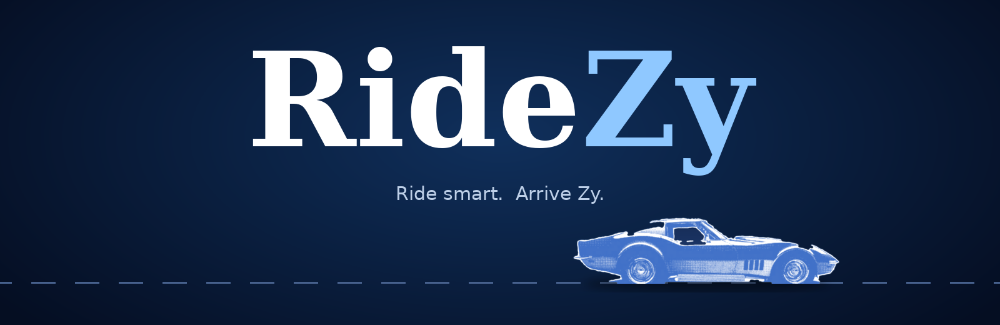

<div align="center">



<a href="#-start-your-engine">
  
</a>

<br><br>


</div>

<br>

## 🎟️ Your boarding pass

```
╭────────────────────────────────────────╮
│  🚗  R I D E Z Y        BOARDING PASS  │
│ ┈┈┈┈┈┈┈┈┈┈┈┈┈┈┈┈┈┈┈┈┈┈┈┈┈┈┈┈┈┈┈┈┈┈┈┈┈┈ │
│  FROM    ➜  anywhere you are           │
│  TO      ➜  wherever you like          │
│  DRIVER  ➜  you pick (yes, really)     │
│  VIBE    ➜  chill 🌊                   │
│  SEAT    ➜  the good one               │
╰────────────────────────────────────────╯
```

<br>

## 🤫 No spoilers

We're keeping the looks a surprise.

Open it. Say hi to the car. Then book a ride. 🏁

<br>

## 🎒 What's in the glovebox

- 🗺️ **Real roads** – routes and distances that match the actual map
- 🧑‍✈️ **You pick the driver** – three offers, one tap, zero awkward
- ⏱️ **Live arrival** – a countdown, an OTP, and a car creeping toward you
- 🌧️ **Rain-aware fares** – the app checks the sky so you don't have to
- 🕐 **Best-time-to-ride** – spots the cheap hours for you
- 💸 **Split the fare** – friends get their share, no maths
- 📅 **Plan ahead** – schedule a ride and get a nudge when it's time
- 🏅 **XP and levels** – ride more, unlock bigger discounts
- 🐶 **Pets, luggage, quiet rides** – tell us how you roll
- 🎵 **Ride vibes** – pick a mood, get a little playlist
- 🛡️ **Safety stuff** – trusted contact, mid-ride check-in, one-tap trip sharing
- 🎙️ **Voice search** – just say where

<br>

## 🏁 The road trip

```
  📍 Trip  ──▶  🚘 Ride  ──▶  💳 Confirm  ──▶  🧑‍✈️ Driver  ──▶  🎉 Arrive
  where to?     pick a car    pay & go        choose & track    rate & ♥ them
```

<br>

## 🚀 Start your engine

1. 📥 **Download** or clone this repo
2. 🖱️ In VS Code, right-click `index.html` → **Open with Live Server**
3. 🚗 **Book your first ride**

> 💡 You'll need internet for the map, place search and fonts. That's all.

<br>

## 🔓 Zero API keys

RideZy runs on free, open services, so there's nothing to sign up for:

- 🗺️ **Map tiles** → Esri / OpenStreetMap
- 🔎 **Place search** → Nominatim
- 🛣️ **Routes** → OSRM
- ⛅ **Weather** → Open-Meteo
- 📍 **Map engine** → Leaflet

<br>

## 🗂️ What's under the hood

```
ridezy/
├── 📄 index.html        the whole app, in one file
├── 🖼️ images/
│   ├── logo.png             the navy car
│   ├── logo_white.png       the bright car
│   └── canvas.jpg           a soft painted sea
└── 📚 docs/             README art
```

<br>

## 🛣️ Where we're headed

- [x] 🗺️ Live routes, fares and driver tracking
- [x] 📅 Scheduling, saved places, favourite drivers, levels
- [ ] 🧑‍✈️ Real drivers and bookings (needs a backend)
- [ ] 💳 Real payments with Razorpay
- [ ] 💬 OTPs by SMS
- [ ] 📱 Install it like a phone app (PWA)

<br>

## 🙋 Quick questions

<details>
<summary><b>Are the drivers real?</b></summary>

<br>

Not yet. They're friendly simulations for now. Real ones need a backend, and that's on the roadmap. 🛠️

</details>

<details>
<summary><b>Why "RideZy"?</b></summary>

<br>

Because it should be easy. And the **Zy** looks great. 😉

</details>

<details>
<summary><b>Do I need an API key?</b></summary>

<br>

Nope. Open it and go. 🔓

</details>

<br>

<div align="center">

**Made with 💙 and a lot of ☕**

*Now go book a ride.* 🚗💨

</div>
